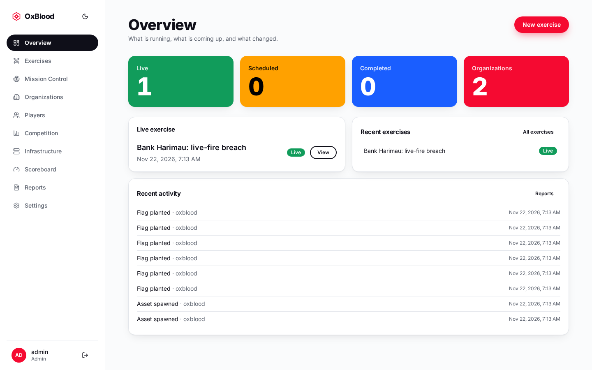
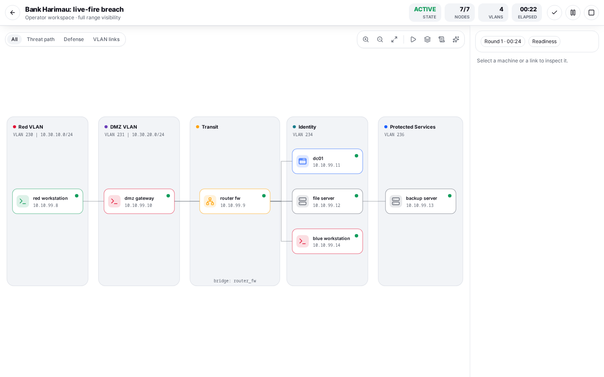
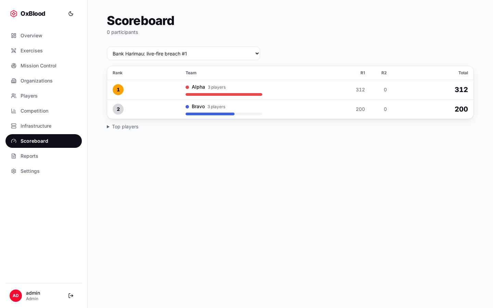
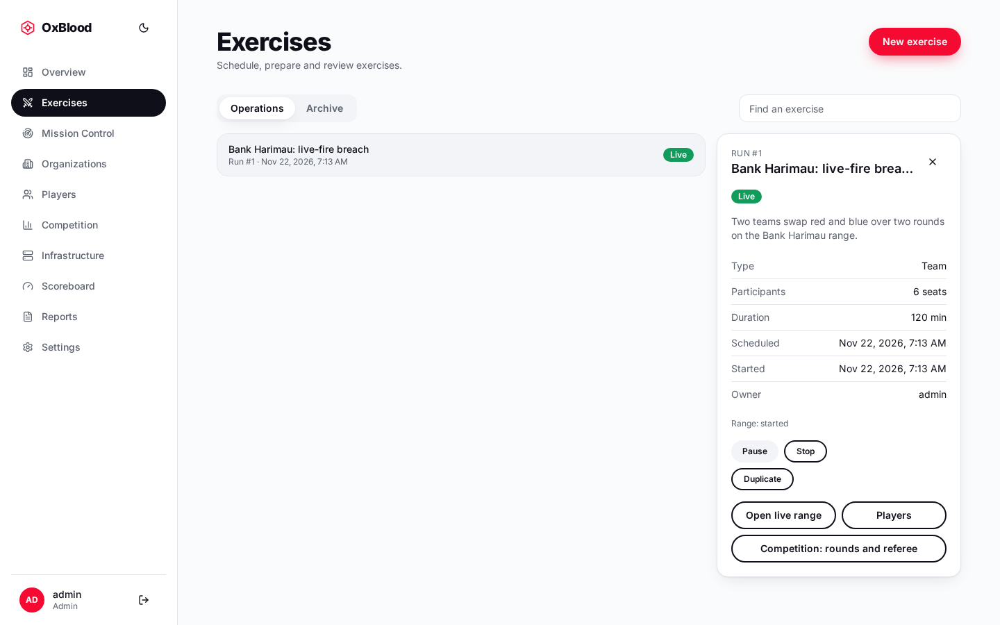
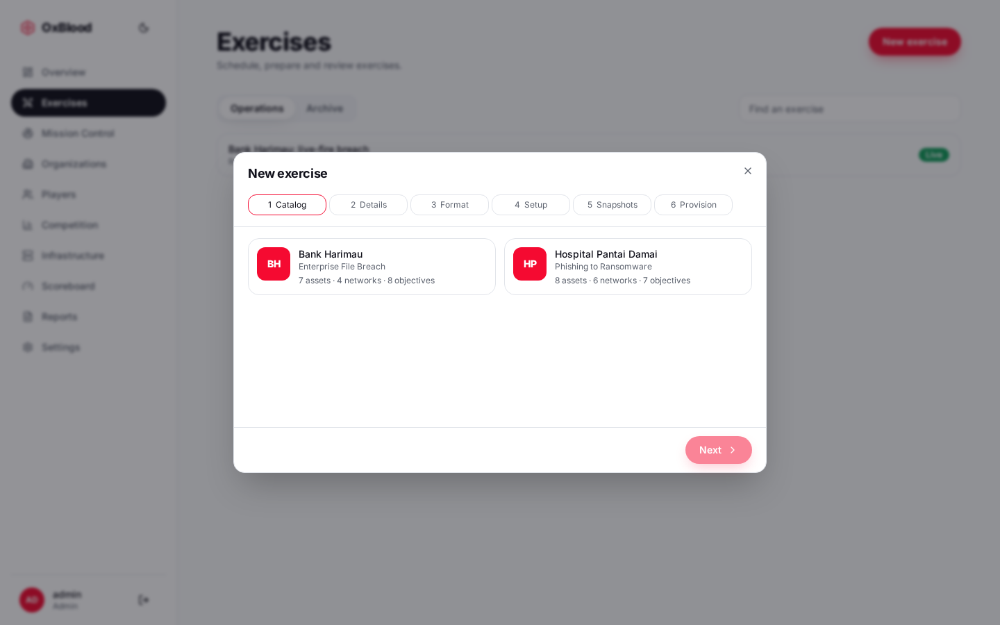
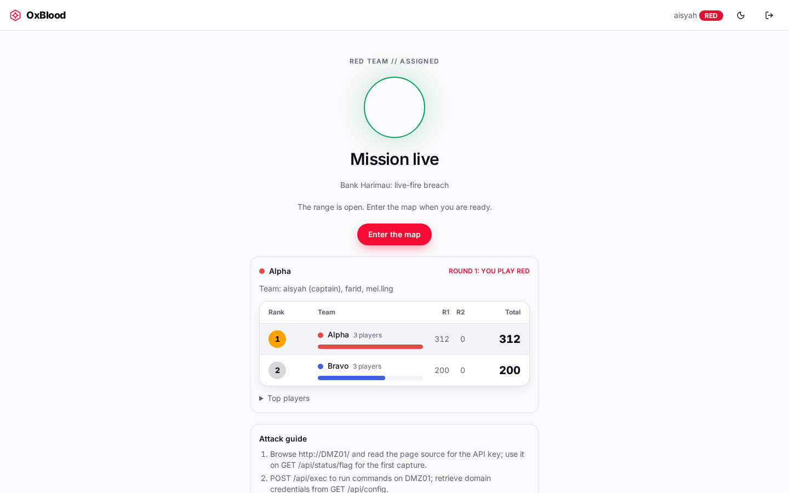
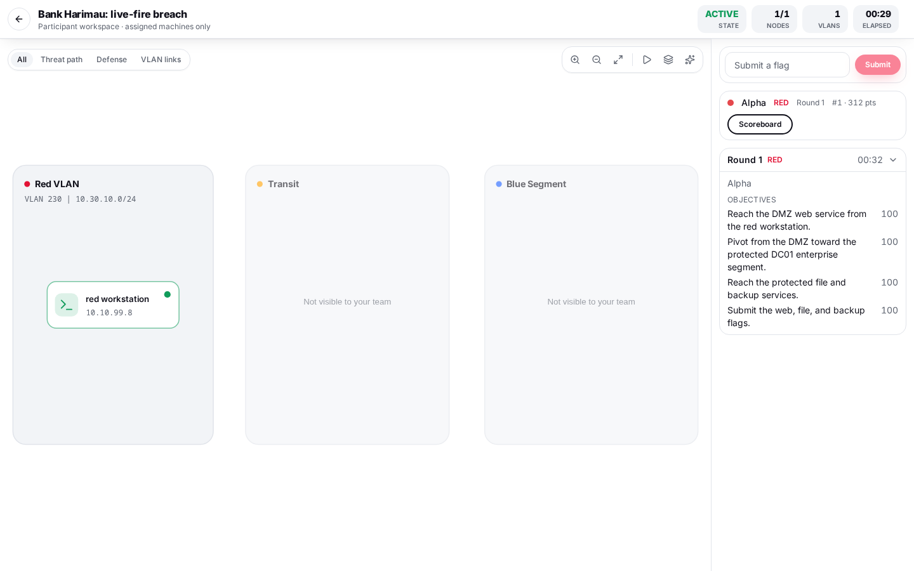
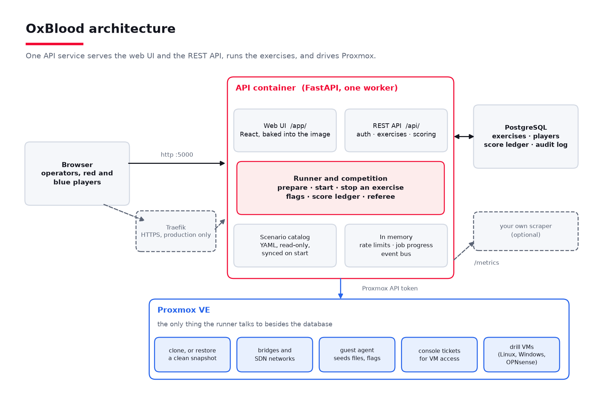

# OxBlood Cyber Drill

A cyber range on your own Proxmox VE. OxBlood provisions scenario VMs, runs red-versus-blue exercises, accepts and scores flags, and writes the reports afterwards.



## Try the demo

No Proxmox needed. The demo runs the full app against an in-memory range and fills it with a live
team competition: two teams, six players, a running range and the first scores.

```bash
git clone https://github.com/aimansam/oxblood.git
cd oxblood
docker compose -f deploy/docker-compose.demo.yml up -d --build
```

Open <http://localhost:5050/app/> and sign in:

| Account | Password | Sees |
| --- | --- | --- |
| `admin` | `OxbloodDemo-2026` | The operator console: exercises, live range, competition, scoreboard |
| `aisyah` | `Player-Demo-2026` | A red player's mission screen and map (team Alpha) |
| `hafiz` | `Player-Demo-2026` | A blue player's mission screen and map (team Bravo) |

Machines are simulated, so there are no consoles to open, and the Infrastructure page and the
Proxmox tab in Settings show Proxmox as unavailable. Everything else is the real application. Stop it with
`docker compose -f deploy/docker-compose.demo.yml down` (the next `up` starts from scratch), or remove it along with
everything else using `scripts/cleanup.sh`. Set `OXBLOOD_DEMO_PORT` to use a port other than 5050.

| | |
| --- | --- |
|  |  |
| **Live range map.** Every machine, link and VLAN, with its state. | **Scoreboard.** Points per team and round. |
|  |  |
| **Exercise details.** Range, players and lifecycle controls. | **New exercise.** From scenario to running range in six steps. |
|  |  |
| **Player view.** Team, side, standings and the attack guide. | **Player map.** Only the machines their team can reach. |

## How it fits together



One service serves both the UI and the API, plus a PostgreSQL database. Rate limits and wizard job progress live in the API's memory, so it runs a single worker. The old `/`, `/login` and `/drill/` URLs redirect to `/app/`.

## Quickstart

```bash
git clone https://github.com/aimansam/oxblood.git
cd oxblood
scripts/install.sh
```

The script takes no arguments and needs Docker with Compose v2. It creates `deploy/.env` (readable only by you) with a generated database
password, token secret and first admin, builds and starts the stack, waits until it is ready, and prints the admin's
password once. It never overwrites an existing `deploy/.env`, so running it again is safe. Then open
<http://localhost:5000/app/>, sign in, and add your Proxmox host and API token under Settings.

To remove it: `scripts/cleanup.sh`. It takes no arguments and asks nothing. It removes the stack, the demo, the
image, the data and `deploy/.env`, after first writing a backup of the database to `~/oxblood-backups`; if that
backup cannot be made, it deletes nothing.

Prefer to do it by hand? `cp deploy/.env.example deploy/.env`, set `POSTGRES_PASSWORD`, `OXBLOOD_TOKEN_SECRET` and the
`OXBLOOD_BOOTSTRAP_ADMIN_*` pair, then `docker compose -f deploy/docker-compose.yml up -d --build`. The bootstrap only
creates an admin that does not exist yet; it never changes an existing password.

Three compose files, all under `deploy/`:

| File | Runs | Use |
| --- | --- | --- |
| `docker-compose.yml` | `api`, `postgres` | The everyday stack, on port 5000 |
| `docker-compose.demo.yml` | `api`, `postgres`, a seeder | The demo above, on port 5050; no Proxmox needed |
| `docker-compose.production.yaml` | `traefik`, `api`, `postgres` | HTTPS with Let's Encrypt; see the [runbook](docs/operations.md) |

Proxmox credentials can also be entered in the web UI under Settings. A Proxmox user id is `<name>@<realm>` and the token id is `<user>!<token-name>`, for example `oxblood@pam!drill-token`.

## What you can do

- **Scenarios.** Each is a YAML file validated against [schemas/scenario.schema.json](schemas/scenario.schema.json). Two ship in [examples/scenarios](examples/scenarios): an enterprise file breach ([range diagram](assets/diagrams/range-enterprise-file-breach.png)) and a phishing-to-ransomware attack ([range diagram](assets/diagrams/range-phish-to-ransom.png)). The diagrams are generated from the YAML.
- **New exercise wizard.** Catalog, details, play format, setup checks, snapshots, then provisioning, with live progress.
- **Free play or team competition.** Teams, rounds with the sides swapped, a score ledger and a scoreboard. See [docs/competition.md](docs/competition.md).
- **Players.** Add them from a pasted list; each gets a generated password that must be replaced at first sign-in.
- **Live range map.** Machines, links and VLANs for operators; assigned machines only for players.
- **Fast ranges from snapshots.** Build clean Proxmox snapshots once and restore them for later exercises. See [docs/range-preparation.md](docs/range-preparation.md).
- **Reports** of what happened in each exercise.

## Development

```bash
scripts/lint-all.sh                    # everything CI runs except the browser tests (about 5 minutes)
cd apps/web && npx playwright test     # browser tests, against a throwaway stack (build the web app first)
```

Individually: `ruff check . && ruff format --check .`, `mypy apps/api/app`,
`pytest apps/api/tests tests` (needs a PostgreSQL database whose name ends in `_test`: set `OXBLOOD_TEST_DB_URL`), and in `apps/web`
`npm run lint && npm test && npm run build`.

After an API change, regenerate the typed client with `python3 tools/export_openapi.py` and then `npm run gen:api`. Where things live is in [docs/monorepo-structure.md](docs/monorepo-structure.md).

## Documentation

| Document | What it covers |
| --- | --- |
| [Operations runbook](docs/operations.md) | What runs, deploying and upgrading, production, health and backups |
| [Range preparation](docs/range-preparation.md) | Lifecycle, capacity checks and snapshot baselines |
| [Running a team competition](docs/competition.md) | Teams, rounds, scoring and referees |
| [Template attack chain](docs/template-attack-chain.md) | The enterprise file breach attack path |
| [Enterprise file breach standard](docs/file-breach-enterprise-standard.md) | What the investigation scenario must provide |
| [Ledger leak scenario](docs/scenario-ledger-leak.md) | A planned scenario: supplier portal leaks a ledger database |
| [Database](docs/database.md) | Entity relationship diagrams of the 27 tables |
| [Monorepo structure](docs/monorepo-structure.md) | Where things live |

## License

MIT, see [LICENSE](LICENSE).

For authorized cybersecurity training and educational use only.
