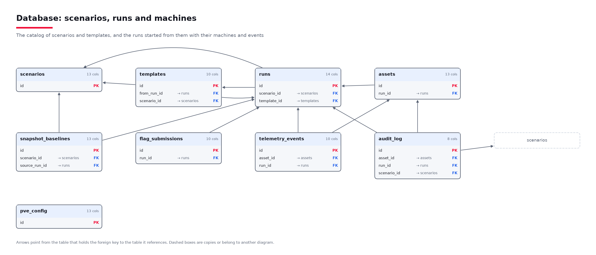
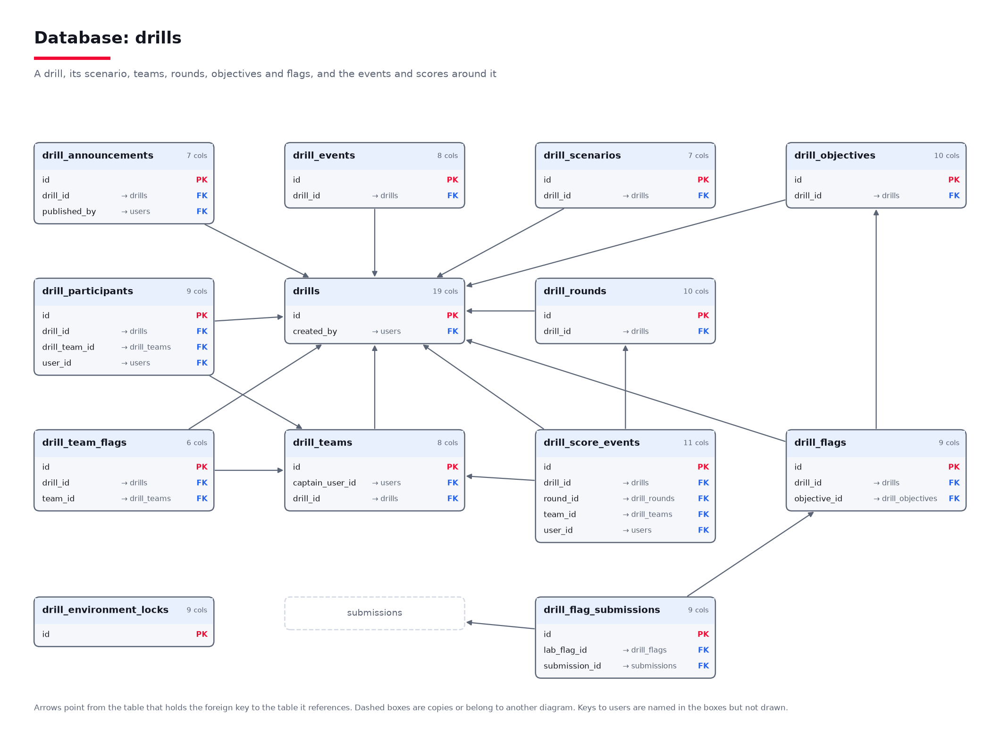
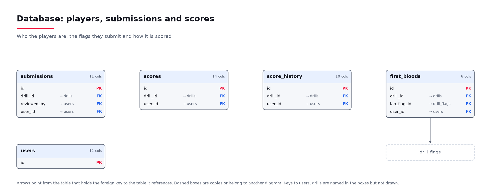

# Database

PostgreSQL holds everything the API keeps: 27 tables, created by the Alembic migrations in
`apps/api/alembic/versions/` (head: `0043_drop_unused_tables`) and described by the SQLAlchemy models in
`apps/api/app/db/models.py` (the first "v1" tables) and `models_drill.py` (the "v2" drill tables). The diagrams below
are drawn from those models by `tools/gen_diagrams.py`, so they follow the schema; each box lists a table's primary key
(PK) and foreign keys (FK, with the table each points at), not every column.

Keys to `users` and `drills` are named in the boxes but not drawn as lines, because nearly every table has one.

## Scenarios, runs and machines

| Table | What it holds |
| --- | --- |
| `scenarios` | One row per scenario YAML file, synced at API start |
| `runs` | One execution of a scenario (the machine lifecycle the runner drives) |
| `assets` | One cloned VM of a run |
| `templates` | An immutable snapshot of an ended run (`runs` and `templates` point at each other) |
| `snapshot_baselines` | A clean, cold Proxmox snapshot of a scenario machine, for fast range restore |
| `flag_submissions` | A captured flag of a run (the run-based API and `tools/watch_drill.py`) |
| `telemetry_events` | An event recorded during a run |
| `audit_log` | Append-only log; no updates or deletes |
| `pve_config` | The one row holding the Proxmox connection |

## Drills

| Table | What it holds |
| --- | --- |
| `drills` | A drill instance and its lifecycle |
| `drill_scenarios` | The scenario a drill uses, with overrides |
| `drill_participants`, `drill_teams` | Who plays, and in which team (a team's side is set per round) |
| `drill_rounds`, `drill_team_flags` | Rounds of a competition and the flag value a team owns in a round |
| `drill_objectives`, `drill_flags`, `drill_flag_submissions` | What to achieve, the flags, and capture attempts |
| `drill_score_events` | Append-only points ledger; team and player scores are sums of these rows |
| `drill_events`, `drill_announcements` | The exercise timeline and operator announcements |
| `drill_environment_locks` | Who holds the single shared range environment |

## Players, submissions and scores

| Table | What it holds |
| --- | --- |
| `users` | Login accounts (referenced by many columns across the schema) |
| `submissions` | Every flag a player submits, right or wrong; `drill_flag_submissions` (above) holds the flag detail |
| `scores`, `score_history` | Free-play points per player (the Scoreboard page) and how they changed |
| `first_bloods` | The first capture of each flag |

Team competitions are scored in `drill_score_events` instead (see Drills). Results of a finished exercise are not stored
as a separate document: the Reports page reads them from the scoreboard, the quality report and the timeline.

## Changing the schema

1. Change the model and add an Alembic migration. Before dropping a table, check the web app: a feature that
   writes it (the free-play Scoreboard writes `scores`, `score_history` and `first_bloods`) needs it even if no
   screen reads it. The test suite builds a PostgreSQL database from the migrations and
   `tests/test_alembic.py` runs the full downgrade and upgrade; see [CLAUDE.md](../CLAUDE.md) for the test database.
2. A new table must be placed on a diagram in `tools/erd_data.py`; `tests/test_erd_data.py` fails until it is.
3. Run `python3 tools/gen_diagrams.py` and commit the new `assets/diagrams/erd-*.png`.
