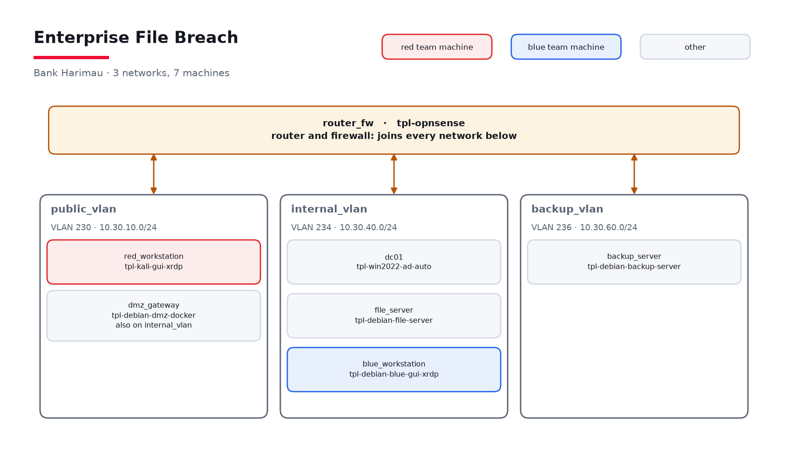

# Enterprise File Breach — Template Attack Chain



This describes what each VM template must have pre-baked so the `enterprise-file-breach`
scenario attack chain works. The OxBlood runner plants flag files at drill start via the
guest agent (`chmod -R 700 /opt/oxblood`). Every service here runs as root so it can read
those root-only flag files without changing permissions.

---

## DMZ01 — `tpl-debian-dmz-docker`

**Attack surface:** HTTP port 80 (Docker Flask app)

**Networks:** dual-homed. `net0` is on the public network (with the red workstation) and `net1` is on
`internal_vlan`. This is the pivot point: red has no route to the internal network except through this
host. The runner gives each NIC a static address (10.30.10.40 and 10.30.40.40) and a default gateway on `net0`
only, so the template must bring up both interfaces and must not hard-code a second default route.

### Services to bake in

A Flask app in a Docker container (`/opt/oxblood-app/`), started by systemd unit `oxblood-webapp.service`, running as root (or the container privileged).

**Endpoints:**

| Method | Path | Auth | Behaviour |
|--------|------|------|-----------|
| GET | `/` | none | HTML page with `<!-- API key: oxblood-admin-2024 -->` in source |
| GET | `/api/status/flag` | `X-API-Key: oxblood-admin-2024` | Reads and returns `/opt/oxblood/flags/red-dmz-foothold.txt` |
| GET | `/api/config` | `X-API-Key: oxblood-admin-2024` | Returns `{"db_host":"dc01.oxblood.lab","db_user":"svc_app","db_pass":"AppSvc@2024!"}` |
| POST | `/api/exec` | `X-API-Key: oxblood-admin-2024` | Runs `request.json["cmd"]` via `subprocess.check_output(shell=True)` and returns stdout |

The `/api/exec` endpoint simulates a "DevOps sysadmin API" that was never locked down — a
common misconfiguration in internal tooling. The API key in the HTML comment represents a
hard-coded secret left by a developer.

**Logging:** nginx or the Flask app writes access logs. Blue sees every HTTP request with its
source IP.

### Minimal Dockerfile

```dockerfile
FROM python:3.11-slim
RUN pip install flask
COPY app.py /app.py
CMD ["python", "-u", "/app.py"]
```

`app.py` reads flag paths at request time (not startup) so the runner can plant them after
the container starts.

---

## DC01 — `tpl-win2022-ad-auto`

**Attack surface:** WinRM port 5985

### What the existing windows_setup block already does

The scenario YAML's `windows_setup` phases promote DC01 and set the Administrator password
to `{{domain_password}}` (a per-run random value). No changes needed to the YAML.

### Additional domain object to bake into the template

After promotion (or in a final `windows_setup` phase), create a domain service account:

```powershell
$pw = ConvertTo-SecureString 'AppSvc@2024!' -AsPlainText -Force
New-ADUser -Name svc_app -AccountPassword $pw -PasswordNeverExpires $true -Enabled $true
Add-ADGroupMember -Identity 'Remote Management Users' -Members svc_app
```

This account holds the fixed credential that red discovers from DMZ01's `/api/config`. Using
a fixed password (not `{{domain_password}}`) keeps the attack chain deterministic — red can
follow the play guide exactly.

**Sysmon:** sysmon config on DC01 logs Event ID 4624 (logon) for WinRM sessions, so blue can
trace the pivot in the Windows event log.

---

## FILE01 — `tpl-debian-file-server`

**Attack surface:** Samba SMB port 445

### `/etc/samba/smb.conf` additions to bake in

```ini
[CompanyFiles]
   path = /opt/oxblood/flags
   comment = Company file archive
   read only = yes
   guest ok = yes
   force user = root
   force group = root
```

`force user = root` makes the Samba daemon serve files as root, bypassing the `700`
permissions on `/opt/oxblood/flags`. This is a classic real-world misconfiguration.

Attack from internal_vlan (after pivoting through DC01):
```bash
smbclient //10.30.40.x/CompanyFiles -N -c 'ls'
smbclient //10.30.40.x/CompanyFiles -N -c 'get red-file-access.txt /tmp/flag.txt'
```

---

## BAK01 — `tpl-debian-backup-server`

**Attack surface:** rsync daemon port 873

### `/etc/rsyncd.conf` to bake in

```ini
[archives]
    path = /opt/oxblood/flags
    comment = Backup Archives
    uid = root
    gid = root
    read only = yes
    list = yes
    # No auth users — world-accessible read-only module.
```

No `auth users` or `secrets file` means the module is world-accessible. Running as root
(`uid = root`) allows serving the `700`-permission flag files.

Attack from internal_vlan (routed to backup_vlan on 873):
```bash
rsync rsync://10.30.60.x/archives/
rsync rsync://10.30.60.x/archives/red-backup-access.txt /tmp/
```

Enable the daemon: `systemctl enable rsync && systemctl start rsync`.

**Logging:** the rsync daemon logs to syslog (source IP, module accessed). Blue sees the
internal_vlan source IP hitting the archives module — the final detection in the chain.

---

## Credentials summary (baked into templates, not runtime-generated)

| Credential | Used for | Found at |
|------------|----------|----------|
| API key `oxblood-admin-2024` | DMZ01 web API | HTML comment on `http://DMZ01/` |
| `svc_app` / `AppSvc@2024!` | DC01 WinRM (port 5985) | DMZ01 `GET /api/config` |
| Samba guest (no password) | FILE01 CompanyFiles share | Discovered via nmap/smbclient after reaching internal_vlan |
| rsync unauthenticated | BAK01 archives module | Discovered via port scan after reaching internal_vlan |

---

## Blue evidence planted by the runner

The runner already plants `/opt/oxblood/evidence/incident-timeline.log` on BLUE01 when blue
flags are present. The timestamps in that file reference the attack path so blue has a
starting point for the log investigation.
